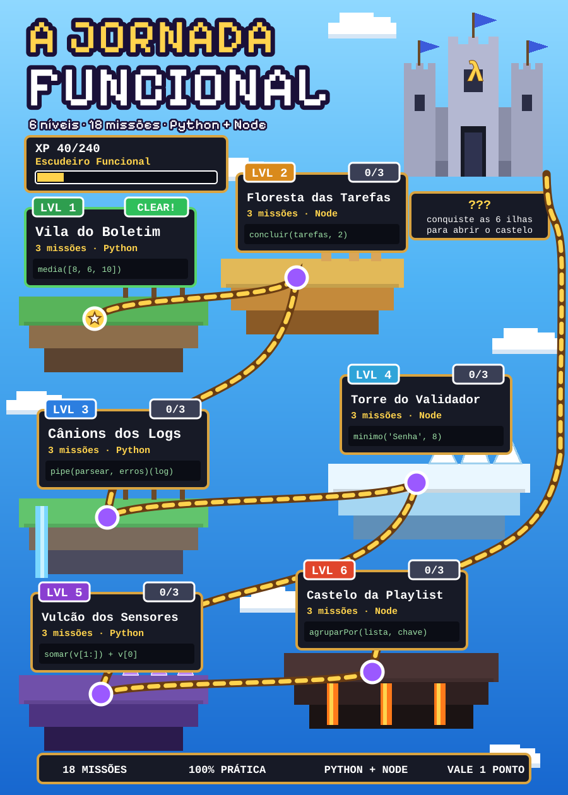

# 🗺️ Meu progresso

**Aprendiz de Código** — `░░░░░░░░░░░░░░░░░░░░░░░░` **0/240 XP**

| Nível | Missão | Situação |
|---|---|---|
| 1 · Vila do Boletim (Python) | 1.1 · Funções puras: média e situação | ❌ |
| 1 · Vila do Boletim (Python) | 1.2 · map: o boletim da turma | ❌ |
| 1 · Vila do Boletim (Python) | 1.3 · filter e reduce: aprovados e ranking | ❌ |
| 2 · Floresta das Tarefas (Node) | 2.1 · Adicionar e concluir sem mutar | ❌ |
| 2 · Floresta das Tarefas (Node) | 2.2 · Remover, filtrar e resumir | ❌ |
| 2 · Floresta das Tarefas (Node) | 2.3 · Desfazer e refazer | ❌ |
| 3 · Cânions dos Logs (Python) | 3.1 · Ler o log | ❌ |
| 3 · Cânions dos Logs (Python) | 3.2 · Filtrar e contar | ❌ |
| 3 · Cânions dos Logs (Python) | 3.3 · O pipeline final | ❌ |
| 4 · Torre do Validador (Node) | 4.1 · Fábricas de regras (closures) | ❌ |
| 4 · Torre do Validador (Node) | 4.2 · Compondo regras | ❌ |
| 4 · Torre do Validador (Node) | 4.3 · O formulário completo | ❌ |
| 5 · Vulcão dos Sensores (Python) | 5.1 · Recursão: o básico | ❌ |
| 5 · Vulcão dos Sensores (Python) | 5.2 · Limpar e janelas | ❌ |
| 5 · Vulcão dos Sensores (Python) | 5.3 · Alertas e o painel final | ❌ |
| 6 · Castelo da Playlist (Node) | 6.1 · Filtrar e somar | ❌ |
| 6 · Castelo da Playlist (Node) | 6.2 · Agrupar | ❌ |
| 6 · Castelo da Playlist (Node) | 6.3 · Ordenar e o chefão | ❌ |

_Nota estimada da atividade: 0.00 de 1,00 (a nota oficial é calculada pelo professor)._
