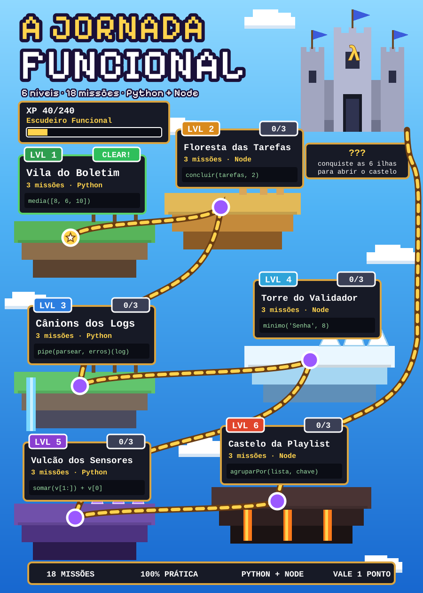

# ⚔️ A Jornada Funcional

**Linguagem de Programação e Paradigmas · UNIDAVI · Sistemas de Informação · Prof. Ademar Perfoll Junior**

<p align="center">
  
</p>

Bem-vindo(a), aventureiro(a)! Para chegar ao castelo você vai cruzar **6 ilhas** e cumprir **18 missões** de programação funcional, **guiadas passo a passo**. Em cada missão você implementa, testa e vê o placar subir. O mapa acima **se atualiza com o seu progresso**.

> **Vale 1 ponto na próxima avaliação.** Entrega pelo GitHub, na sua própria conta.

## 🗺️ As seis ilhas

| Nível | Local | Linguagem | O que você aprende |
|---|---|---|---|
| 1 | Vila do Boletim | Python | funções puras, `map`, `filter`, `reduce` |
| 2 | Floresta das Tarefas | Node (JS ou TS) | imutabilidade e "desfazer" |
| 3 | Cânions dos Logs | Python | pipeline de transformações |
| 4 | Torre do Validador | Node (JS ou TS) | closures e composição |
| 5 | Vulcão dos Sensores | Python | recursão e síntese |
| 6 | Castelo da Playlist | Node (JS ou TS) | agrupar e ordenar (o chefão) |

Cada nível tem uma pasta com um `LEIAME.md` (a história, o conceito em 1 minuto e o passo a passo), o arquivo para você editar e os testes. **Comece pelo Nível 1** e siga em ordem.

## 🎮 Como jogar

1. **Prepare o equipamento:** [`PREPARAR_AMBIENTE.md`](PREPARAR_AMBIENTE.md) (Windows + VS Code; dicas para Mac e Linux).
2. Na página do jogo (https://github.com/juniorbsn-ui/jornada-funcional), clique em **Use this template → Create a new repository** e crie o seu repositório `lpp-quest-SUA_MATRICULA`.
3. Abra a pasta no VS Code e leia o `LEIAME.md` do Nível 1.
4. Implemente uma função por vez e rode o placar no terminal:
   ```
   python quest.py          # todos os níveis (no Mac/Linux: python3)
   python quest.py 1        # detalhes do nível 1
   ```
5. A cada missão concluída, faça `git add .`, `git commit` e `git push`.

Atalho no VS Code: `Ctrl+Shift+B` roda o placar.

## ✨ XP, títulos e conquistas

| | |
|---|---|
| Missão concluída | **+10 XP** |
| Nível limpo (3 missões ✅) | **+10 XP** de bônus |
| Total da jornada | **240 XP** |

| XP | Título |
|---|---|
| 0 | Aprendiz de Código |
| 40 | Escudeiro Funcional |
| 100 | Cavaleiro da Pureza |
| 160 | Mago da Composição |
| 240 | **Lenda Funcional** |

**Conquistas** (só para se divertir, não valem nota): 🔁 **Zero laços** (nível sem `for`/`while`) e 🧊 **Mãos limpas** (nível sem alterar dados recebidos).

## 📜 Regras da jornada

- **Funções puras e dados imutáveis.** Não altere as listas e os objetos que a sua função recebe. Os testes avisam quando isso acontece.
- **Não edite os arquivos de teste** (`test_*.py`, `*.test.mjs`) nem a pasta `tools/`. A nota usa os testes oficiais do professor, então mexer nos seus não muda nada.
- **Pode usar documentação e IA para entender**, mas a missão só vale de verdade se **você consegue explicar o que escreveu**. Tente primeiro, peça ajuda depois.
- **Node: JavaScript ou TypeScript?** Você escolhe. Por padrão o jogo usa os `.js`. Para usar TypeScript: `python quest.py escolher ts`.

## 📦 Entrega

- **Prazo:** 08/11/2026 às 23:59
- **Repositório:** `lpp-quest-SUA_MATRICULA`, na **sua** conta do GitHub, [DEFINIR: privado ou público]. Se for privado, adicione **juniorbsn-ui** como colaborador (*Settings → Collaborators*).
- **URL:** informe a URL do repositório na atividade aberta no Classroom.
- **Vale o último commit até o prazo.** Faça commits ao longo da jornada.
- **Nota:** 1 ponto, proporcional ao seu XP nos testes oficiais (por exemplo, 120 de 240 XP valem 0,50).
- **Dúvidas:** através do e-mail do professor ou em sala de aula.

## 🧰 O que tem aqui

| Item | Para quê |
|---|---|
| `nivel1_boletim/` ... `nivel6_playlist/` | as seis ilhas: `LEIAME.md`, arquivo para editar e testes |
| `quest.py` | o placar do jogo (roda os testes, calcula o XP e atualiza o mapa) |
| `PROGRESSO.md` | o seu progresso (atualizado pelo placar) |
| `PREPARAR_AMBIENTE.md` | instalação para Windows, Mac e Linux |
| `tools/` | motor do jogo (não edite) |  
| `.github/workflows/quest.yml` | roda o placar no GitHub a cada push (aba **Actions**) |

Boa jornada! 🏰

---

<sub>Créditos: o título do mapa foi desenhado com a fonte Pixelify Sans (SIL Open Font License); a licença está em `assets/PixelifySans-OFL.txt`.</sub>
